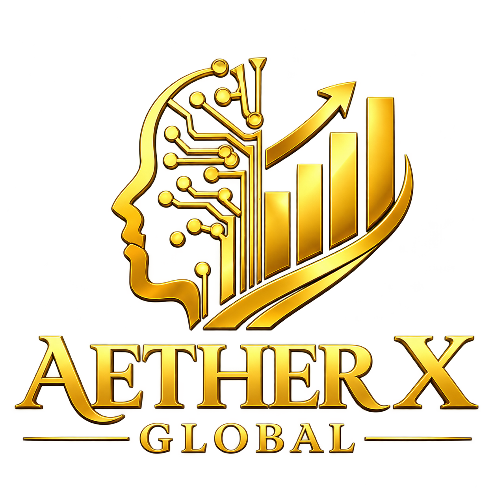

# AETHER X GLOBAL — Brand & Social Design Hub

**Start here before creating or editing any AETHER X GLOBAL social image.**

**Status:** Proposed on a review branch. Founder-approved direction for **future** LinkedIn/Facebook graphics; this becomes the canonical GitHub design hub only after the PR is reviewed and merged.

## Official transparent logo

[Download the original transparent PNG](assets/aether-x-global-founder-original-20261019.png) · [Check its exact hash and provenance](LOGO_ASSET_REGISTER.md). The brand asset must be composited **unchanged**; AI must not redraw it.

## Required reading

1. [Social Visual Design Standard V1.0](SOCIAL_VISUAL_DESIGN_STANDARD_V1.md) — exact composition, approved visual families, palette, typography, rejection gates and publishing limitations.
2. [Logo Source & Integrity Register](LOGO_ASSET_REGISTER.md) — distinguish original corporate logo assets from secondary banners and AI-drawn derivatives.
3. [Public Portfolio Status](../PUBLIC_PORTFOLIO_STATUS.md) — current public maturity categories, publication and support limits.
4. [AETHER X Corporate Identity](https://github.com/AETHERXGLOBAL/aether-x-governance/blob/main/sources/AETHER_X_GLOBAL.md) — higher-authority corporate identity.
5. The product's own current `README.md`, `docs/STATUS.md` and evaluation guide on verified remote HEAD.

## Designer / agent operating rule

**Read the standard, verify the product, then draw its actual mechanism.** Never lead with a generic cube, hacker imagery, a made-up user interface, or customer/partner logos. Build an original scene *without* the brand mark, and only then composite the unchanged founder-approved logo as a separate locked layer. Design approval is not approval to publish.

### Mandatory output per creative

- PNG export (sRGB), editable source, platform/crop preview.
- One true statement about product capability, an explicit maturity state, and one source-backed CTA.
- A short evidence pack: linked source, checked HEAD/status, asset origin/hash, claim caveats, caption and factual alt text.
- Approval decision: `ACCEPT` / `REVISE` before posting.

## Discovery

Public organization homepage: https://github.com/AETHERXGLOBAL

Publication on LinkedIn or Facebook requires **separate founder authorization** for exact image, account, caption and timing. A GitHub merge never authorizes posting.
